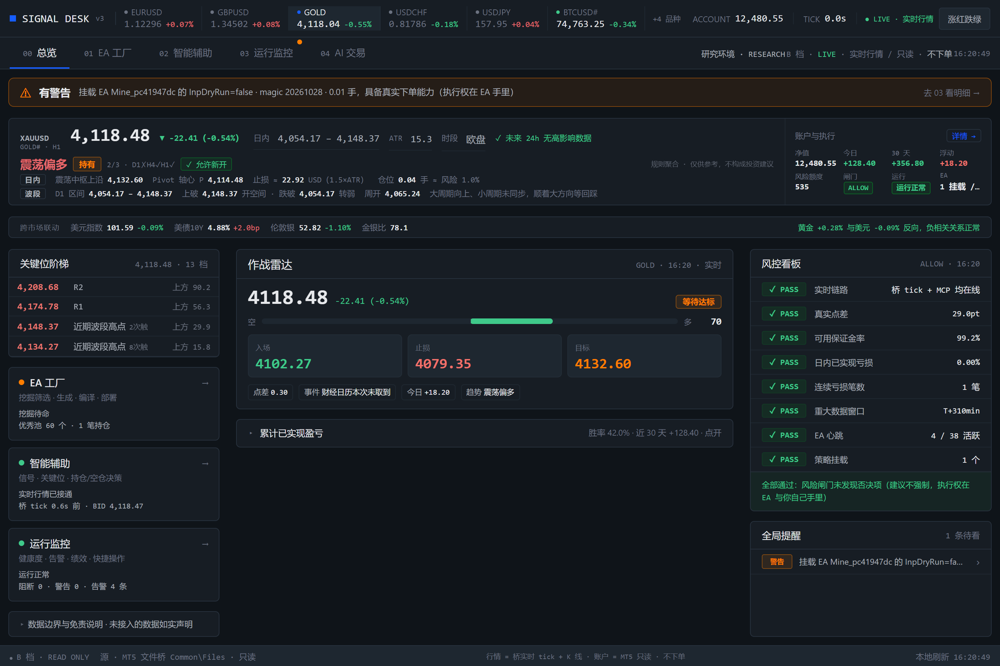
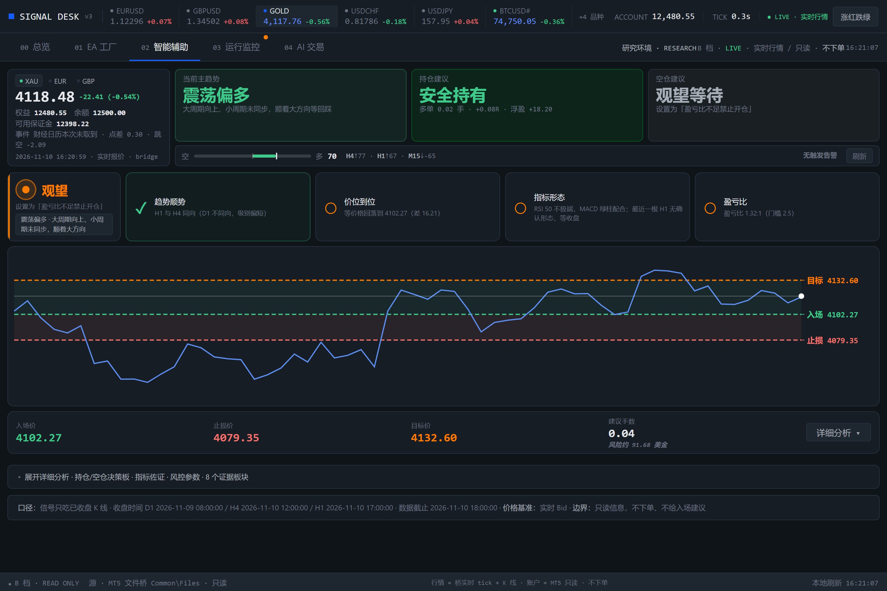
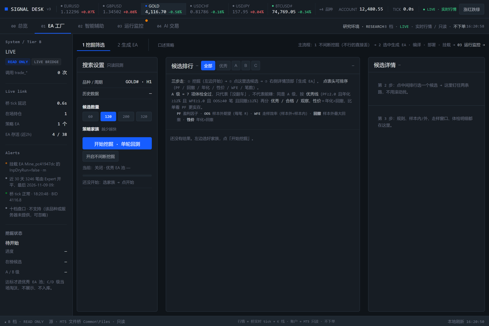
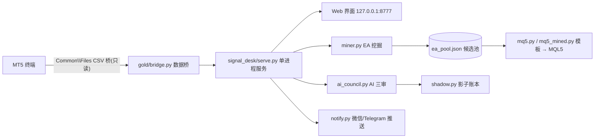
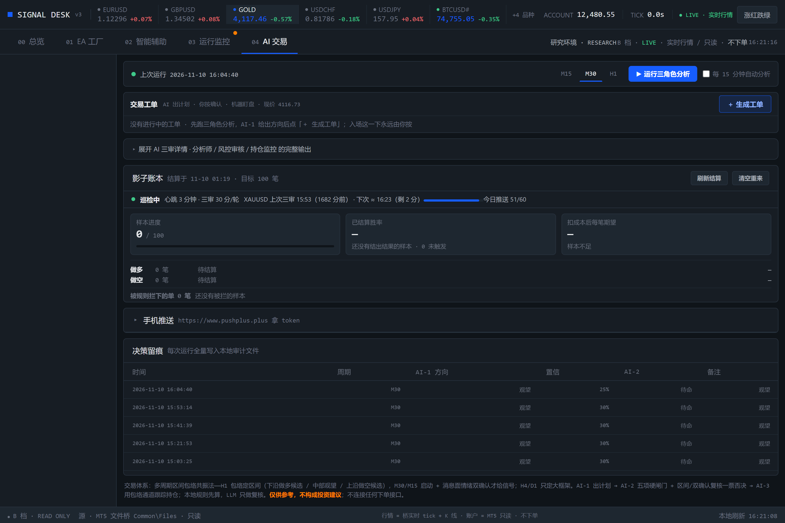

# SIGNAL DESK · 黄金/外汇智能辅助信号台

> 一套跑在本机、只读不改单的**人工交易辅助系统**：多周期信号看板 + EA 自动挖掘工厂 + AI 三审决策 + 影子账本复盘。所有 K 线计算只吃**已收盘 bar**，信号仅供参考，不构成投资建议。



## ✨ 它是什么

SIGNAL DESK 面向「人用 MT5 下单、系统只负责提供信息」的工作流，核心原则是**只读、不下单、不预测、不编造**：

| 模块 | 功能 |
|---|---|
| **00 总览** | 作战雷达：市场温度、入场/止损/目标三个关键数字、风险闸门矩阵、全局告警置顶 |
| **01 EA 工厂** | 全自动挖掘交易策略：参数扫描 → 初筛 → 深验（WFA+样本外）→ 分级入池 → 一键生成 MQL5 EA |
| **02 智能辅助** | 8 板块 K 线信息看板：多周期共振、关键位、指标、形态、四条件红绿灯矩阵、图表化交易计划 |
| **03 运行监控** | 链路健康、EA 心跳、点差、告警审计 |
| **04 AI 交易** | AI 三审（方向审核 → 风险审核 → 持仓结算）+ 影子账本：只记录不结算的真实样本，验证信号质量 |



## 🔑 设计要点

- **只吃收盘 K 线**：所有指标/形态/信号计算基于 `t + 周期 ≤ now` 的已收盘 bar，盘中不抖动、不重绘、不用未来函数
- **四条件门槛**：趋势匹配 / 关键价位 / 指标形态 / 盈亏比 ≥ 2.5，全部达标才算「合格信号」，页面红绿灯 + 浏览器响铃 + 微信推送三路提醒
- **EA 干跑交付链**：生成 `.mq5` → MetaEditor 编译 → 部署 MT5 → 挂载，全程 `InpDryRun=true` 只自报成绩、绝不下单；EA 左上角自带可视化面板
- **影子账本**：合格信号自动记账，用后续行情按真实点差/滑点结算，积累 R 值样本验证信号期望；黄金主账本与外汇副账本物理隔离
- **推送分级**：价位告警 / 达标信号 / AI 工单 / 影子结算四类推送，带防轰炸冷却、夜间静默、每日上限
- **数据可信度**：桥接文件只读（`READ ONLY`），系统与下单接口物理隔离



## 🏗 架构





## 🚀 快速开始

> 仅支持 Windows + MetaTrader 5（数据桥依赖 MT5 的 Common\Files）。

```bash
# 1. 克隆
git clone https://github.com/dsq8260/signal-desk.git
cd signal-desk

# 2. 建立虚拟环境（Python 3.10+）
python -m venv .venv
.venv\Scripts\pip install numpy pandas requests

# 3. 拷贝示例配置到运行时目录，按需修改
mkdir signal_desk\data
copy config-examples\*.json signal_desk\data\

# 4. 启动（或直接双击 signal_desk\启动信号台.bat）
.venv\Scripts\python signal_desk\serve.py
```

浏览器访问 `http://127.0.0.1:8777/`。首次启动会自动扫描 MT5 桥接文件；如提示链路离线，检查 MT5 是否运行、桥接 EA 是否挂载。

**推送配置**：在 04 页「手机推送」折叠卡里选渠道（PushPlus / 企业微信 / Telegram / Bark 等），填 token 保存并发送测试。

## 📁 目录结构

```
signal_desk/     服务与界面（serve.py 入口，index.html + theme.css 单屏界面）
gold/            数据桥、MT5 通信、策略挖掘与回测库
src/validation/  绩效指标（夏普年化、回撤表）
mql5/            GoldBridge.mq5 桥接 EA 源码
config-examples/ 示例配置（脱敏）
docs/            截图与文档
tests/           单元测试
```

## 🔒 安全与隐私

- 仓库不含任何密钥、账户数据与运行时状态（`.llm_key.json`、`signal_desk/data/`、行情 CSV 均已排除）
- 系统生成的 EA 一律 `InpDryRun=true`，交付链会复检该开关，非干跑直接拒收
- 所有配置文件首次运行自动生成，或从 `config-examples/` 拷贝

## 🤝 参与贡献

欢迎一起优化这套系统！推荐流程：

1. **提建议 / 报 bug**：直接开 [Issue](https://github.com/dsq8260/signal-desk/issues)，描述现象、复现步骤和预期行为，附截图更好
2. **改代码**：Fork 仓库 → 新建分支 → 提交修改 → 发起 [Pull Request](https://github.com/dsq8260/signal-desk/pulls)，说明改了什么、为什么改
3. **约定**：
   - 保持核心红线不变：只读不下单、只吃已收盘 K 线、EA 强制 `InpDryRun=true`
   - 不引入任何密钥 / 账户数据到仓库
   - UI 改动请附前后对比截图

本项目基于 [MIT License](LICENSE) 开源，允许自由使用、修改与二次分发。

## ⚠️ 免责声明

本项目为**个人研究与信息辅助工具**：不构成投资建议，不承诺收益，不参与任何下单行为。信号基于历史数据计算，过去表现不代表未来结果。外汇/贵金属杠杆交易风险极高，请自行评估并自负盈亏。
